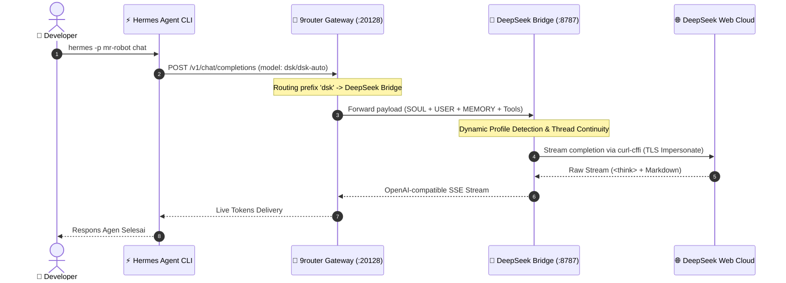

<div align="center">

# ⚡ DEEPSEEK BRIDGE PORTABLE
### *Enterprise-Grade, Zero-Token-Cost OpenAI Gateway with Native Hermes Dynamic Introspection*

[](https://github.com/Muhammad-Rizqullah-Akbar)
[](https://opensource.org/licenses/MIT)
[](https://nodejs.org/)
[](https://www.python.org/)
[](https://chat.deepseek.com)
[](https://github.com/nousresearch/hermes-agent)
[](CONTRIBUTING.md)

<p align="center">
  
</p>

[Fitur Utama](#-fitur-utama) • [Alur Integrasi](#-alur-integrasi-sistem) • [Batasan Headless](#-batasan-otentikasi-gui-vs-headless-vps) • [Quickstart](#-quickstart-3-langkah) • [Etika Penggunaan](#-manifesto-penggunaan-beretika--apresiasi-deepseek) • [Kontribusi](#-komunitas-kontribusi--kolaborasi-open-source) • [Lisensi](#-lisensi--penafian-hukum)

---
</div>

> [!IMPORTANT]
> **🚀 Zero-Cost Autonomous Infrastructure:** DeepSeek Bridge menjembatani Web Engine DeepSeek V3 / R1 menjadi endpoint standar OpenAI (`http://127.0.0.1:8787/v1`) dengan context window native **890,880 token**. Dirancang untuk menjalankan beban kerja agen otonom (seperti **Hermes Agent CLI / Desktop**) tanpa perlu membayar tagihan token API komersial.

---

## 🌟 Fitur Utama

- 🧠 **Dynamic Hermes Introspection:** Bebas path hardcode. Bridge memindai direktori profil Hermes (`%LOCALAPPDATA%\hermes` atau `~/.hermes`) secara runtime, membaca `SOUL.md`, `USER.md`, dan `memories/` untuk mengisolasi context thread per profil secara otomatis.
- 🔄 **Stateful Session Continuity:** 1 Sesi percakapan Hermes dipetakan ke 1 `chat_session_id` DeepSeek tanpa membuat chat baru di setiap turn. Menghemat bandwidth hingga 95% dan mencegah flagging abuse oleh firewall hulu.
- 🛡️ **Penta-Layer Cognitive Defense:** Dilengkapi refusal neutralizer bawaan, token censorship sanitizer, dan XML tool emulator untuk eksekusi workflow coding tanpa henti.
- 🔀 **Dynamic Multi-Account Pooling:** Menyeimbangkan beban request ke banyak akun DeepSeek sekaligus (`acc1`, `acc2`, dst) menggunakan scheduler round-robin adaptif dengan interval pendinginan cerdas.
- 📦 **Clean-Slate & Zero-Leakage:** Kredensial, cookie sesi, dan file database tersimpan relatif di `data/session/` dan 100% diabaikan oleh `.gitignore`. Sangat aman untuk di-clone atau dipindahkan lintas perangkat.
- 🔌 **1-Click 9router Connector:** Terintegrasi langsung dengan 9router Gateway (`:20128`) menggunakan payload valid (`apiType: "chat"`).

---

## 🔄 Alur Integrasi Sistem



---

## ⚠️ Batasan Otentikasi: GUI vs Headless VPS

> [!WARNING]
> **Pahami Alur Autentikasi Sebelum Memasang di Server/VPS:**
>
> 1. **Login Pertama Membutuhkan Tampilan Desktop GUI:**
>    DeepSeek menerapkan verifikasi puzzle captcha Cloudflare dan OTP email saat login pertama. Playwright **wajib membuka jendela browser visual** (`headless=False`) untuk menangkap sesi awal.
> 2. **Tidak Mendukung Login Langsung di Headless Linux VPS Tanpa Monitor:**
>    Jika Anda menjalankan `deepseek-bridge login` di Linux VPS murni tanpa X11 / Wayland, Playwright akan melempar error `cannot open display`.
> 3. **Solusi Portabilitas Lintas Perangkat:**
>    Lakukan login sekali di laptop/PC lokal Anda. Salin file `data/session/<nama>/session.json` (format Plain JSON) ke folder VPS Anda di `data/session/<nama>/session.json`. Bridge di VPS langsung aktif seketika menggunakan `curl-cffi` tanpa butuh display browser!

---

## 🖥️ Audit Diagnostik Pre-Flight

Bridge dilengkapi auditor bawaan yang memeriksa kesiapan sistem operasi sebelum server dijalankan:

```text
================================================================================
           DEEPSEEK BRIDGE PORTABLE - PRE-FLIGHT SYSTEM AUDIT
================================================================================

[1] RUNTIME & BINARY DEPENDENCIES:
    ├─ [OK] Python v3.12.2 (64-bit)
    ├─ [OK] Node.js v22.23.4 (9router WebIDL & zstd compatible)
    ├─ [OK] PoW Engine (Wasmtime)          : wasmtime vready
    ├─ [OK] TLS Fingerprint (curl-cffi)    : curl_cffi v0.17.0
    ├─ [OK] Browser Engine (Playwright)    : Driver terpasang
    └─ [OK] Port 8787 TERSEDIA             : Siap digunakan

[2] 9ROUTER GATEWAY STATUS:
    └─ [OK] Online (2.3s) — Model 'dsk/dsk-auto, dsk/dsk' aktif di 9router

[3] HERMES DYNAMIC PROFILES:
    ├─ Hermes Root Detected: C:\Users\HP\AppData\Local\hermes
    ├─ Terdeteksi 4 Profil Dinamis:
    │   • default            : SOUL.md (663b)  | Model: dsk/dsk-auto
    │   • mr-robot           : SOUL.md (663b)  | Model: dsk/dsk-auto
    │   • elliot-alderson    : SOUL.md (663b)  | Model: dsk/dsk-auto
    │   • darlene-alderson   : SOUL.md (663b)  | Model: dsk/dsk-auto
    └─ Status: Terintegrasi Modular

[4] DEEPSEEK ACCOUNT POOL:
    └─ [CLEAN SLATE] Siap digunakan untuk round-robin pooling.
================================================================================
```

---

## 🚀 Quickstart (3 Langkah)

### 1. Inisialisasi Otomatis (1-Click)
```bash
git clone https://github.com/Muhammad-Rizqullah-Akbar/deepseek-bridge-portable.git
cd deepseek-bridge-portable

# Di Windows:
.\bootstrap.bat

# Di Linux / macOS:
chmod +x bootstrap.sh && ./bootstrap.sh
```

### 2. Jalankan Pre-Flight Auditor
```bash
deepseek-bridge check
```

### 3. Sinkronisasi 9router & Hermes
```bash
# Injeksi bridge ke 9router Gateway
deepseek-bridge connect xenonite

# Injeksi konfigurasi global Hermes (890k context window)
deepseek-bridge setup-hermes

# Mulai berdialog dengan agen Hermes pilihanmu!
hermes -p mr-robot chat
```

---

## 🎛️ Referensi Perintah CLI

| Perintah | Deskripsi |
| :--- | :--- |
| `deepseek-bridge check` | Audit komprehensif runtime, biner, port, dan profil agen |
| `deepseek-bridge init` | Inisialisasi template folder data lokal dan driver Playwright |
| `deepseek-bridge dashboard` *(alias `ui`, `gui`)* | Membuka Web Dashboard GUI di browser (auto-launch server jika belum aktif) |
| `deepseek-bridge serve` | Menjalankan server gateway OpenAI-compatible di port 8787 |
| `deepseek-bridge connect` | Menginjeksi node provider dan koneksi otomatis ke 9router |
| `deepseek-bridge setup-hermes` | Mengunci konfigurasi global Hermes ke 890,880 token context |
| `deepseek-bridge accounts list` | Menampilkan tabel status akun dan validitas sesi pool |
| `deepseek-bridge accounts add <n>` | Mendaftarkan slot akun baru ke antrean pooling |
| `deepseek-bridge login <n>` | Membuka jendela browser visual untuk login OTP/Captcha |

---

## 🕊️ Manifesto Penggunaan Beretika & Apresiasi untuk DeepSeek

> [!NOTE]
> ### 💙 Penghormatan untuk Tim DeepSeek
> **DeepSeek adalah penyedia AI Open-Source sejati (bukan sekadar open-weight), dan itulah keunggulan paling monumental serta hadiah terbesar mereka bagi peradaban teknologi dunia.**
> Keberanian dan komitmen mereka merilis arsitektur model, kode, dan bobot secara terbuka penuh (*truly open-source*) dengan performa frontier kelas dunia telah mendemokratisasi akses kecerdasan buatan, meruntuhkan hegemoni korporasi tertutup, dan membuka gerbang inovasi bagi jutaan developer di seluruh dunia. Kami menaruh rasa hormat, apresiasi, dan terima kasih yang setinggi-tingginya kepada seluruh peneliti dan insinyur di DeepSeek.

### 🎯 Mengapa Proyek Ini Diciptakan?
Proyek ini lahir murni sebagai inisiatif jembatan bagi para **mahasiswa, peneliti independen, developer pemula, dan pembelajar mandiri** yang memiliki keterbatasan finansial dan sumber daya komputasi. Tujuannya adalah agar rekan-rekan pembelajar tetap dapat merasakan kehebatan arsitektur agen otonom tingkat lanjut (seperti ekosistem Nous Hermes) menggunakan model frontier tanpa terhalang tembok biaya API komersial.

### ⚖️ Panduan Etika: Jangan Berlebihan & Jangan Serakah
Agar ekosistem ini tetap sehat dan dapat dinikmati bersama, kami menyerukan prinsip tanggung jawab bersama:
1. **Gunakan dengan Wajar:** Jangan melakukan *request flooding*, *bot scraping* masif, atau menjalankan puluhan instans paralel yang tidak perlu sehingga membebani infrastruktur server publik DeepSeek.
2. **Cukup 1–2 Akun:** Gunakan pool secara wajar untuk kebutuhan riset, pair-programming personal, dan belajar mandiri.
3. **Dukung DeepSeek saat Anda Mampu:** Jika aplikasi atau riset Anda kelak telah menghasilkan keuntungan finansial atau digunakan secara komersial, **berlanggananlah dan belilah API token resmi langsung dari DeepSeek**. Itu adalah wujud apresiasi nyata untuk keberlangsungan inovasi mereka.

*Teruslah bereksplorasi, kembangkan keahlian rekayasa Anda, dan tebarkan manfaat bagi sesama pembelajar. Salam hangat untuk seluruh komunitas pengembang agen mandiri!*

---

## 🤝 Komunitas, Kontribusi & Kolaborasi Open Source

Proyek ini dibangun secara independen dan **terbuka lebar untuk kolaborasi pengembang global**. Jika Anda menemukan celah perbaikan, bug hulu, atau ingin menambahkan kapabilitas baru:

### Saluran Komunikasi & Kolaborasi:
- 💡 **Diskusi Ide & Arsitektur:** Buka [GitHub Discussions](https://github.com/Muhammad-Rizqullah-Akbar/deepseek-bridge-portable/discussions).
- 🐛 **Pelaporan Masalah / Bug:** Buka [GitHub Issues](https://github.com/Muhammad-Rizqullah-Akbar/deepseek-bridge-portable/issues) menggunakan formulir terstruktur kami.
- 📬 **Kontak Author:** Hubungi via email di **`inirizqullahakbar@gmail.com`**.
- 🛠️ **Panduan Kontribusi:** Baca [CONTRIBUTING.md](CONTRIBUTING.md) untuk pedoman branching dan pengujian PR.

### 🎯 Roadmap & Open Bounties:
- 🐳 **Docker + Xvfb Virtual Framebuffer:** Kontainerisasi agar penangkapan sesi browser visual dapat dijalankan langsung di VPS tanpa display fisik.
- 🧩 **Multi-Agent Adapters:** Integrasi langsung ke Claude Code, AutoGen, CrewAI, dan LangChain.
- 📊 **Telemetry Dashboard UI:** Peningkatan grafik visualisasi penggunaan token real-time dan monitoring latensi request di web dashboard.

---

## 📜 Lisensi & Penafian Hukum

Didistribusikan di bawah lisensi resmi **MIT License**. Hak Cipta (c) 2026 **inirizqullahakbar & Kontributor**. Lihat file [LICENSE](LICENSE) untuk informasi lengkap.

> **Penafian Hukum:** Proyek ini merupakan tools otomasi mandiri untuk tujuan riset rekayasa protokol dan integrasi agen lokal. Proyek ini tidak berafiliasi, didukung, atau dikembangkan oleh DeepSeek Inc. Pengguna bertanggung jawab penuh atas kepatuhan terhadap ketentuan layanan penyedia terkait.
