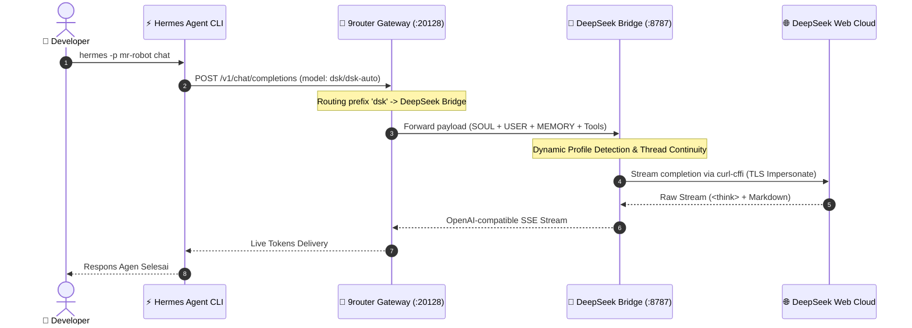

<div align="center">

# ⚡ DEEPSEEK BRIDGE PORTABLE
### *Enterprise-Grade, Zero-Token-Cost OpenAI Gateway with Native Hermes Dynamic Introspection*

[](https://github.com/inirizqullahakbar)
[](https://opensource.org/licenses/MIT)
[](https://nodejs.org/)
[](https://www.python.org/)
[](https://chat.deepseek.com)
[](https://github.com/nousresearch/hermes-agent)
[](CONTRIBUTING.md)

<p align="center">
  
</p>

[Arsitektur Inti](#-arsitektur-inti) • [Batasan Headless vs GUI](#-batasan-penting-gui-vs-headless) • [Quickstart](#-quickstart-3-langkah) • [Komunitas & Kontribusi](#-komunitas-kontribusi--kolaborasi-open-source) • [Lisensi & Penafian](#-lisensi--penafian-hukum)

---
</div>

> [!IMPORTANT]
> **🚀 Zero-Cost Autonomous Infrastructure:** DeepSeek Bridge menjembatani Web Engine DeepSeek V3 / R1 menjadi endpoint standar OpenAI (`http://127.0.0.1:8787/v1`) dengan context window native **890,880 token**. Dirancang khusus untuk autonomous agent runner (seperti **Hermes Agent CLI / Desktop**) tanpa perlu membayar tagihan token API komersial.

---

## 🌟 Arsitektur Inti

- 🧠 **Dynamic Hermes Introspection:** Bebas path hardcode. Bridge memindai direktori profil Hermes (`%LOCALAPPDATA%\hermes` atau `~/.hermes`) secara runtime, membaca `SOUL.md`, `USER.md`, dan `memories/` untuk mengisolasi context thread per profil secara otomatis.
- 🔄 **Stateful Thread Continuity:** 1 Sesi percakapan Hermes dipetakan ke 1 `chat_session_id` DeepSeek tanpa membuat chat baru di setiap turn. Menghemat bandwidth hingga 95% dan mencegah flagging abuse oleh firewall hulu.
- 🛡️ **Penta-Layer Cognitive Defense:** Dilengkapi refusal neutralizer bawaan, token censorship sanitizer, dan XML tool emulator untuk eksekusi workflow coding tanpa henti.
- 🔀 **Dynamic Multi-Account Pooling:** Menyeimbangkan beban request ke banyak akun DeepSeek sekaligus (`acc1`, `acc2`, dst) menggunakan scheduler round-robin adaptif dengan interval pendinginan cerdas.
- 📦 **Clean-Slate & Zero-Leakage:** Kredensial, cookie sesi, dan file database tersimpan relatif di `data/session/` dan 100% diabaikan oleh `.gitignore`. Sangat aman untuk di-clone atau dipindahkan lintas perangkat.
- 🔌 **1-Click 9router Connector:** Terintegrasi langsung dengan 9router Gateway (`:20128`) menggunakan payload valid (`apiType: "chat"`).

---

## ⚠️ Batasan Penting: GUI vs Headless

> [!WARNING]
> **Pahami Alur Autentikasi Sebelum Memasang di Server/VPS:**
>
> 1. **Login Pertama Membutuhkan Tampilan Desktop GUI:**
>    DeepSeek menerapkan verifikasi puzzle captcha Cloudflare dan OTP email saat login pertama. Playwright **wajib membuka jendela browser visual** (`headless=False`) untuk menangkap sesi awal.
> 2. **Tidak Mendukung Login Langsung di Headless VPS Tanpa Monitor:**
>    Jika Anda menjalankan `deepseek-bridge login` di Linux VPS murni tanpa X11 / Wayland, Playwright akan melempar error `cannot open display`.
> 3. **Solusi Portabilitas Lintas Perangkat:**
>    Lakukan login sekali di laptop/PC lokal Anda. Salin file `data/session/<nama>/session.json` (format Plain JSON) ke folder VPS Anda di `data/session/<nama>/session.json`. Bridge di VPS langsung aktif seketika menggunakan `curl-cffi` tanpa butuh display browser!

---

## 🔄 Alur Integrasi Sistem



---

## 🚀 Quickstart (3 Langkah)

### 1. Inisialisasi Otomatis (1-Click)
```bash
git clone https://github.com/inirizqullahakbar/deepseek-bridge-portable.git
cd deepseek-bridge-portable

# Di Windows:
.\bootstrap.bat

# Di Linux / macOS:
chmod +x bootstrap.sh && ./bootstrap.sh
```

### 2. Jalankan Pre-Flight Auditor
```bash
deepseek-bridge check
```
Auditor akan memverifikasi kesiapan Node.js (>=22.0.0), dependensi biner (`wasmtime`, `curl-cffi`, `playwright`), ketersediaan port 8787, koneksi 9router, serta profil Hermes lokal.

### 3. Sinkronisasi 9router & Hermes
```bash
# Injeksi bridge ke 9router Gateway
deepseek-bridge connect xenonite

# Injeksi konfigurasi global Hermes (890k context window)
deepseek-bridge setup-hermes

# Mulai gunakan agen Hermes favoritmu!
hermes -p mr-robot chat
```

---

## 🤝 Komunitas, Kontribusi & Kolaborasi Open Source

Proyek ini dibangun secara independen dan **terbuka lebar untuk kolaborasi pengembang global**. Jika Anda menemukan celah perbaikan, bug hulu, atau ingin menambahkan kapabilitas baru:

### Saluran Komunikasi & Kolaborasi:
- 💡 **Diskusi Ide & Arsitektur:** Buka [GitHub Discussions](https://github.com/inirizqullahakbar/deepseek-bridge-portable/discussions).
- 🐛 **Pelaporan Masalah / Bug:** Buka [GitHub Issues](https://github.com/inirizqullahakbar/deepseek-bridge-portable/issues) menggunakan formulir laporan terstruktur kami.
- 📬 **Kontak Langsung:** Hubungi author via email di **`inirizqullahakbar@gmail.com`**.
- 🛠️ **Pull Requests:** Silakan baca panduan kontribusi lengkap di [CONTRIBUTING.md](CONTRIBUTING.md).

### 🎯 Roadmap & Open Bounties:
- 🐳 **Docker + Xvfb Virtual Display:** Penambahan containerization dengan virtual display agar login Playwright dapat dijalankan langsung di VPS tanpa layar fisik.
- 🧩 **Multi-Agent Adapters:** Integrasi langsung ke Claude Code, AutoGen, CrewAI, atau framework agentik lainnya.
- 📊 **Telemetry Dashboard UI:** Peningkatan grafik visualisasi penggunaan token dan monitoring latensi request di web dashboard.

---

## 📜 Lisensi & Penafian Hukum

Didistribusikan di bawah lisensi resmi **MIT License**. Lihat file [LICENSE](LICENSE) untuk klausul lengkap.

> **Penafian Hukum:** Proyek ini merupakan tools otomasi mandiri untuk tujuan riset rekayasa protokol dan integrasi agen lokal. Proyek ini tidak berafiliasi, didukung, atau dikembangkan oleh DeepSeek Inc. Pengguna bertanggung jawab penuh atas kepatuhan terhadap ketentuan layanan penyedia terkait.
