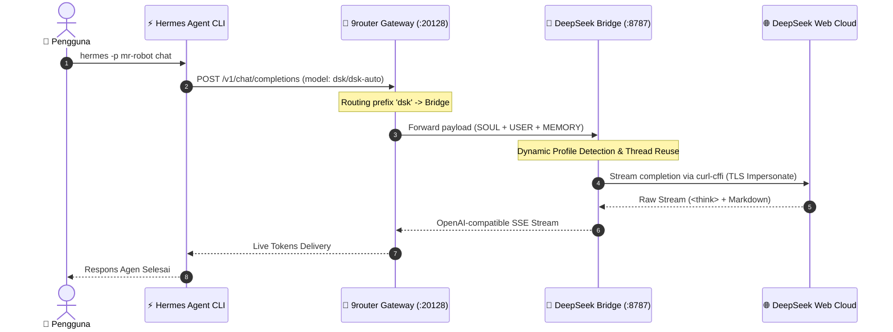

<div align="center">

# ⚡ DEEPSEEK BRIDGE PORTABLE
### *Enterprise-Grade, Zero-Token-Cost OpenAI Gateway with Native Hermes Dynamic Introspection*

[](https://nodejs.org/)
[](https://www.python.org/)
[](https://opensource.org/licenses/MIT)
[](https://chat.deepseek.com)
[](https://github.com/nousresearch/hermes-agent)
[](CONTRIBUTING.md)

<p align="center">
  
</p>

[Fitur Utama](#-fitur-utama) • [Batasan Headless](#-batasan-penting-gui-vs-headless) • [Quickstart](#-quickstart-3-langkah) • [Kontribusi & Kolaborasi](#-berkontribusi--komunitas-developer) • [Lisensi](#-lisensi--penafian-disclaimer)

---
</div>

> [!IMPORTANT]
> **🚀 Zero-Cost Intelligence:** DeepSeek Bridge mengubah sesi web DeepSeek V3 / R1 menjadi endpoint standar OpenAI (`http://127.0.0.1:8787/v1`) dengan kuota context native **890,880 token**. Dirancang khusus untuk agen autonomous (seperti **Hermes Agent CLI / Desktop**) tanpa perlu membayar tagihan token API komersial.

---

## 🌟 Fitur Utama

- 🧠 **Dynamic Hermes Introspection:** Bebas hardcode path! Otomatis mendeteksi direktori profil Hermes (`%LOCALAPPDATA%\hermes` atau `~/.hermes`), membaca `SOUL.md`, `USER.md`, dan `memories/` secara realtime.
- 🔄 **Stateful Thread Continuity:** 1 Sesi percakapan Hermes dipetakan ke 1 `chat_session_id` DeepSeek tanpa membuat chat baru di setiap turn (mencegah akun kena suspend / spam bot).
- 🛡️ **Penta-Layer Cognitive Defense:** Perlindungan bawaan terhadap refusal neutralizer, token censorship sanitizer, dan XML tool emulator untuk eksekusi coding tanpa henti.
- 🔀 **Multi-Account Round-Robin Pool:** Menyeimbangkan beban request ke banyak akun DeepSeek sekaligus (`acc1`, `acc2`, dst) untuk throughput tinggi tanpa batas.
- 📦 **Clean-Slate & Zero-Leakage:** Kredensial dan cookie sesi tersimpan relatif di `data/session/` dan 100% diabaikan oleh `.gitignore`. Aman di-clone dan di-share kapan saja.
- 🔌 **1-Click 9router Connector:** Terintegrasi langsung dengan 9router Gateway (`:20128`) dengan skema payload valid (`apiType: "chat"`).

---

## ⚠️ Batasan Penting: GUI vs Headless

> [!WARNING]
> **Pahami Alur Autentikasi Sebelum Memasang di Server/VPS:**
>
> 1. **Login Pertama Wajib Memiliki Layar / Desktop GUI:**
>    DeepSeek menggunakan puzzle captcha Cloudflare dan verifikasi OTP email saat login pertama. Playwright **harus membuka browser visual** (`headless=False`) untuk login awal.
> 2. **Tidak Bisa Langsung Login di Headless Linux VPS Tanpa Display:**
>    Jika kamu menjalankan `deepseek-bridge login` di VPS murni tanpa monitor / X11, Playwright akan melempar error `cannot open display`.
> 3. **Solusi Portabilitas Lintas Perangkat:**
>    Lakukan login sekali di laptop/PC lokal Anda. Salin file `data/session/<nama>/session.json` (format Plain JSON) ke folder VPS Anda di `data/session/<nama>/session.json`. Bridge di VPS langsung aktif seketika menggunakan `curl-cffi` tanpa butuh display browser!

---

## 🔄 Alur Integrasi Sistem



---

## 🚀 Quickstart (3 Langkah)

### 1. Inisialisasi Otomatis (1-Click)
```bash
git clone https://github.com/<username>/deepseek-bridge-portable.git
cd deepseek-bridge-portable

# Di Windows:
.\bootstrap.bat

# Di Linux / macOS:
chmod +x bootstrap.sh && ./bootstrap.sh
```

### 2. Jalankan Pre-Flight Auditor
```bash
deepseek-bridge check
```
Memverifikasi kesiapan Node.js (>=22.0.0), dependensi biner (`wasmtime`, `curl-cffi`, `playwright`), status port 8787, koneksi 9router, serta profil Hermes lokal.

### 3. Sinkronisasi 9router & Hermes
```bash
# Injeksi bridge ke 9router Gateway
deepseek-bridge connect xenonite

# Injeksi konfigurasi global Hermes (890k context window)
deepseek-bridge setup-hermes

# Mulai gunakan agen Hermes favoritmu!
hermes -p mr-robot chat
```

---

## 🤝 Berkontribusi & Komunitas Developer

Proyek ini dibangun secara open-source untuk komunitas AI agent, hacker, dan reverse engineer. Kami sangat terbuka terhadap kontribusi, saran perbaikan, maupun fitur baru!

### Cara Berkontribusi:
1. **Fork** repositori ini & buat branch fitur baru (`git checkout -b feature/ide-brilian`).
2. Jalankan `deepseek-bridge check` untuk memastikan tidak ada regresi.
3. Kirim **Pull Request (PR)** dengan penjelasan teknis yang komprehensif.
4. Baca panduan kontribusi lengkap di [CONTRIBUTING.md](CONTRIBUTING.md).

### 💡 Ide Pengembangan Terbuka:
- 🐳 **Docker + Xvfb:** Kontainerisasi dengan virtual display agar login Playwright bisa berjalan di VPS tanpa monitor fisik.
- 🧩 **Multi-Agent Adapters:** Integrasi langsung ke Claude Code, AutoGen, CrewAI, atau framework LLM lainnya.
- 📊 **Telemetry Dashboard:** Peningkatan grafik monitoring performa token dan latensi di UI dashboard web.

> **Punya pertanyaan atau ingin berdiskusi arsitektur?**
> Buka [GitHub Issues](https://github.com/<username>/deepseek-bridge-portable/issues) atau mulai diskusi di [GitHub Discussions](https://github.com/<username>/deepseek-bridge-portable/discussions). Kami siap berkolaborasi!

---

## 📜 Lisensi & Penafian (Disclaimer)

Didistribusikan di bawah **MIT License**. Lihat file [LICENSE](LICENSE) untuk informasi lengkap.

> **Penafian Hukum:** Proyek ini merupakan perkakas otomasi mandiri untuk tujuan riset dan integrasi agen lokal. Proyek ini tidak berafiliasi, didukung, atau dikembangkan oleh DeepSeek Inc. Pengguna bertanggung jawab penuh atas penggunaan dan kepatuhan terhadap ketentuan layanan penyedia terkait.
