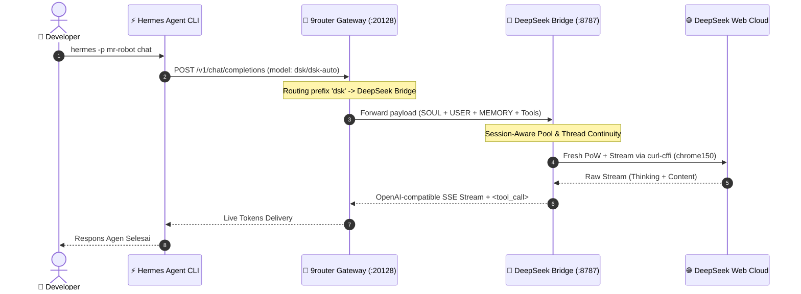
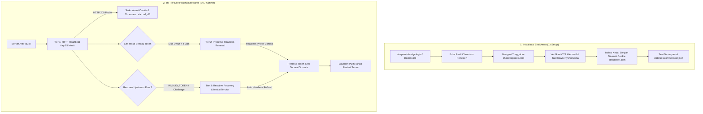

<div align="center">

# ⚡ DEEPSEEK BRIDGE PORTABLE
### *OpenAI-Compatible Local Gateway with Native Hermes Introspection & Multi-Account Session Pooling*

[](https://github.com/Muhammad-Rizqullah-Akbar)
[](https://opensource.org/licenses/MIT)
[](https://www.python.org/)
[](https://nodejs.org/)
[](https://chat.deepseek.com)
[](https://github.com/nousresearch/hermes-agent)
[](CONTRIBUTING.md)

<p align="center">
  
</p>

[Fitur Utama](#-fitur-utama) • [Arsitektur & Alur Sistem](#-arsitektur--alur-sistem) • [Quickstart](#-quickstart-panduan-penggunaan) • [Ketahanan Sesi 24/7](#-arsitektur-sesi-247--protokol-autentikasi) • [Referensi CLI](#-referensi-lengkap-perintah-cli) • [Etika & Apresiasi](#-manifesto-penggunaan-beretika--apresiasi-untuk-deepseek) • [Kontribusi](#-komunitas-kontribusi--kolaborasi-open-source) • [Lisensi](#-lisensi--penafian-hukum)

---
</div>

> [!NOTE]
> **AI-Generated Documentation (Written by AI):** Seluruh dokumentasi `README.md` ini disusun dan diperbarui dengan bantuan AI (*written by AI*) berdasarkan peninjauan langsung terhadap basis kode proyek.

> [!IMPORTANT]
> **Local OpenAI-Compatible Infrastructure:** DeepSeek Bridge Portable menjembatani sesi web DeepSeek menjadi endpoint API standar OpenAI (`http://127.0.0.1:8787/v1`) dengan *context window* hingga **890,880 token**. Dirancang agar selaras dengan alur kerja agen otonom (**Hermes Agent CLI / Desktop**) dan gateway lokal (**9router**), lengkap dengan Web Dashboard manajemen akun dan API Key.

---

## 🌟 Fitur Utama

- 🧠 **Dynamic Hermes Introspection:** Memindai direktori profil Hermes (`%LOCALAPPDATA%\hermes` atau `~/.hermes`) secara dinamis pada saat runtime, membaca `SOUL.md`, `USER.md`, dan `memories/` untuk mengisolasi konteks *thread* per profil secara otomatis tanpa konfigurasi path manual.
- 🔄 **Stateful Session Continuity:** Memetakan satu sesi percakapan Hermes (`thread_key`) ke satu `chat_session_id` DeepSeek secara persisten. Request lanjutan hanya mengirimkan delta percakapan baru sehingga menghemat token/bandwidth serta menjaga kontinuitas *KV-cache*.
- 🔀 **Session-Aware Multi-Account Pooling:** Mendistribusikan beban ke banyak akun DeepSeek dengan pelacakan konkurensi berbasis sesi (`active_sessions` per `thread_key`). Request lanjutan dalam room chat yang sama tidak saling memblokir, sedangkan batas konkurensi hanya diterapkan pada sesi paralel yang berbeda.
- 🔐 **Fresh WASM PoW & Sinkronisasi TLS `chrome150`:** Mengambil tantangan Proof-of-Work terbaru di setiap request dan menyelesaikannya secara lokal melalui sandbox `wasmtime` (`sha3_wasm_bg.wasm`), dipadukan dengan `curl_cffi >= 0.17.0` (`impersonate="chrome150"`, mendukung hingga `chrome152`).
- 🛠️ **Hermes-Native Tooling Protocol:** Menyeragamkan pemanggilan *tool* ke format `<tool_call>` JSON yang tervalidasi ketat (`[REQUIRED]` fields), dilengkapi narasi aktivitas singkat berbahasa Indonesia sebelum eksekusi tool serta dukungan *streaming* `reasoning_content` via SSE.
- 🖥️ **Web Dashboard & Interactive 9router Connector:** Menyediakan dashboard terintegrasi (`http://127.0.0.1:8787/`) untuk manajemen akun, pembuatan API Key, tombol **Salin** API Key penuh, pemantauan kuota/telemetry, serta pemilihan API Key secara interaktif saat menghubungkan ke 9router Gateway (`:20128`).
- 📦 **Zero-Leakage Repository Design:** Seluruh kredensial lokal (`.env`, `keys.json`, `data/session/`), log, dan berkas sementara diabaikan sepenuhnya oleh `.gitignore`, sementara `.env.example` tetap disertakan sebagai templat konfigurasi.

---

## 🔄 Arsitektur & Alur Sistem



---

## 🚀 Quickstart (Panduan Penggunaan)

### Prasyarat
- **Python 3.10+** (direkomendasikan 3.11 / 3.12 / 3.14)
- **Node.js 22+** (untuk ekosistem 9router Gateway)
- **Lingkungan Desktop GUI** untuk login akun pertama kali (lihat catatan [GUI vs Headless VPS](#-batasan-otentikasi-gui-vs-headless-vps))

### Langkah 1 — Clone & Jalankan Installer
Installer otomatis membuat *virtual environment* lokal (`.venv`), memasang seluruh dependensi (termasuk `curl-cffi>=0.17.0`, `wasmtime`, dan `playwright`), serta menyiapkan perintah `deepseek-bridge`:

```bash
git clone https://github.com/Muhammad-Rizqullah-Akbar/deepseek-bridge-portable.git
cd deepseek-bridge-portable

# Windows:
.\bootstrap.bat

# Linux / macOS:
chmod +x bootstrap.sh && ./bootstrap.sh
```

*(Opsional)* Salin `.env.example` menjadi `.env` jika ingin menyesuaikan port, batas konkurensi, atau parameter timeout.

### Langkah 2 — Audit Lingkungan & Jalankan Server
```bash
# Verifikasi kesiapan Python, Wasmtime, curl_cffi, Playwright, dan port
deepseek-bridge check

# Jalankan gateway & Web Dashboard di http://127.0.0.1:8787/
deepseek-bridge serve
```

### Langkah 3 — Kelola API Key & Login Akun DeepSeek
1. Buka **Web Dashboard** di **`http://127.0.0.1:8787/`** (atau jalankan `deepseek-bridge dashboard`).
2. Pada panel **API Key**, buat key baru lalu klik tombol **Salin** untuk menyalin token penuhnya.
3. Pada panel **Akun**, tambahkan dan login akun DeepSeek Anda (atau via CLI `deepseek-bridge login acc1`). Setelah login berhasil dan sesi tersimpan ke `data/session/<nama>/session.json`, jendela browser dapat ditutup.

### Langkah 4 — Hubungkan ke 9router & Hermes
```bash
# Injeksi provider & API Key bridge ke 9router Gateway (:20128)
# Jika sudah ada beberapa API Key, CLI akan menampilkan menu pilihan key secara interaktif
deepseek-bridge connect

# Konfigurasikan Hermes agar mengarah ke model dsk/dsk-auto
deepseek-bridge setup-hermes

# Mulai sesi agen Hermes Anda
hermes -p mr-robot chat
```

---

## ⚠️ Batasan Otentikasi: GUI vs Headless VPS

> [!WARNING]
> **Alur Autentikasi untuk Server / VPS Tanpa Tampilan Grafis:**
>
> 1. **Login Pertama Membutuhkan Tampilan Desktop GUI:**
>    DeepSeek menerapkan verifikasi captcha interaktif dan OTP email saat login pertama. Playwright membuka jendela browser visual (`headless=False`) untuk menangkap sesi awal secara aman.
> 2. **Headless Linux VPS:**
>    Menjalankan `deepseek-bridge login` di VPS tanpa X11/Wayland akan menghasilkan error `cannot open display`.
> 3. **Solusi Portabilitas:**
>    Lakukan login satu kali di PC/laptop lokal Anda, lalu salin berkas `data/session/<nama>/session.json` ke direktori yang sama di VPS. Bridge di VPS akan langsung aktif menggunakan `curl_cffi` tanpa memerlukan display grafis.

---

## 🛡️ Arsitektur Sesi 24/7 & Protokol Autentikasi

DeepSeek Bridge Portable dirancang untuk menjaga kestabilan sesi jangka panjang (*uptime* 24/7) dengan perilaku koneksi yang konsisten dengan klien web standar:



### 1. Persistent Chromium Profile (Satu Akun, Satu Sandbox)
Setiap akun memiliki direktori profil terpisah di `data/session/<nama>/profile`:
- Cookie jar, Web Storage, IndexedDB, dan Device ID tersimpan persisten di disk lokal.
- Penguncian profil lama (*stale lock*) dibersihkan secara aman sebelum browser dibuka kembali.

### 2. Protokol Penangkapan Sesi Bersih & Co-Existence Webmail
- **Single-Hit Navigation:** Browser menavigasi halaman login tepat satu kali dan memantau ketersediaan token secara pasif tanpa *reload* berulang.
- **Webmail Co-Existence:** Bila menggunakan webmail (seperti Proton Mail) untuk mengambil kode OTP, buka tab baru di jendela browser yang sama. Bridge membatasi pembacaan hanya pada origin `.deepseek.com` sehingga data tab lain tidak pernah tersentuh.
- **Zero DOM Clutter:** Penangkapan sesi dilakukan langsung dari konteks penyimpanan browser tanpa menyuntikkan elemen pop-up tambahan ke halaman.

### 3. Tri-Tier Keepalive & Ketahanan Concurrency
1. **Tier 1 (Lightweight Heartbeat — tiap 15 menit):** Memeriksa kesehatan sesi via `/api/v0/users/current` menggunakan `curl_cffi` (`impersonate="chrome150"`) dengan set header XHR yang konsisten (`sec-ch-ua`, `sec-fetch-mode: cors`, `sec-fetch-site: same-origin`, `default_headers=False`).
2. **Tier 2 (Proactive Headless Renewal):** Memperbarui sesi secara *headless* di latar belakang sebelum masa berlaku token berakhir (< 4 jam) hanya ketika tidak ada request aktif pada akun tersebut.
3. **Tier 3 (Isolasi Error Terukur & Session-Aware Pool):**
   - `LoginRequired` mengisolasi akun selama **180 detik** untuk mencegah kegagalan berulang, sedangkan *exception* sementara hanya memicu pendinginan singkat (`COOLDOWN_SECONDS = 5s`).
   - Antrean akuisisi akun (`FAILOVER_ACQUIRE_TIMEOUT = 60.0s`) menunggu akun pemilik *thread* secara sabar untuk mengakomodasi proses *reasoning* yang panjang tanpa memutus kontinuitas sesi.

---

## 🖥️ Audit Diagnostik Pre-Flight

Jalankan `deepseek-bridge check` untuk memverifikasi kesiapan seluruh dependensi sebelum menjalankan server:

```text
================================================================================
           DEEPSEEK BRIDGE PORTABLE - PRE-FLIGHT SYSTEM AUDIT
================================================================================

[1] RUNTIME & BINARY DEPENDENCIES:
    ├─ [OK] Python v3.12+ (64-bit)
    ├─ [OK] Node.js v22+ (Kompatibilitas 9router Gateway)
    ├─ [OK] PoW Engine (Wasmtime)          : wasmtime ready
    ├─ [OK] TLS Fingerprint (curl_cffi)    : curl_cffi >= 0.17.0 (chrome150 ready)
    ├─ [OK] Browser Engine (Playwright)    : Driver terpasang
    └─ [OK] Port 8787 TERSEDIA             : Siap digunakan

[2] 9ROUTER GATEWAY STATUS:
    └─ [OK] Online — Model 'dsk/dsk-auto, dsk/dsk' aktif di 9router

[3] HERMES DYNAMIC PROFILES:
    ├─ Hermes Root Detected: %LOCALAPPDATA%\hermes (atau ~/.hermes)
    ├─ Terdeteksi Profil Dinamis (default, mr-robot, elliot-alderson, dll.)
    └─ Status: Terintegrasi Modular

[4] DEEPSEEK ACCOUNT POOL:
    └─ Status akun & validitas session.json terverifikasi.
================================================================================
```

---

## 🎛️ Referensi Lengkap Perintah CLI

```text
deepseek-bridge <subcommand> [aksi] [argumen] [opsi]
```

### 1. Server & Visual Control
| Perintah | Alias | Deskripsi |
| :--- | :--- | :--- |
| `deepseek-bridge serve` | — | Menjalankan server gateway OpenAI-compatible di port 8787 (mendukung `--reload`) |
| `deepseek-bridge dashboard` | `ui`, `gui` | Membuka Web Dashboard GUI di browser default |
| `deepseek-bridge check` | — | Menjalankan audit diagnosa menyeluruh (Python, Wasmtime, `curl_cffi`, Playwright, Port, 9router, Hermes) |
| `deepseek-bridge init` | — | Inisialisasi struktur folder data lokal (`data/session`, `data/state`) dan browser engine |
| `deepseek-bridge status` | — | Memeriksa ringkasan status akun terdaftar dan validitas sesi di disk |

### 2. Autentikasi & Browser Sesi
| Perintah | Alias | Deskripsi & Contoh |
| :--- | :--- | :--- |
| `deepseek-bridge login [nama]` | — | Membuka jendela browser interaktif untuk login manual OTP/Captcha (`deepseek-bridge login acc1`) |
| `deepseek-bridge browse [nama]` | `open` | Membuka browser visual profil akun untuk verifikasi atau inspeksi manual |

### 3. Manajemen Pool Akun (`accounts`)
| Perintah | Deskripsi & Parameter |
| :--- | :--- |
| `deepseek-bridge accounts list` | Menampilkan seluruh akun di pool, email, status sesi, dan prioritas |
| `deepseek-bridge accounts add <nama>` | Menambahkan akun baru ke registry (`deepseek-bridge accounts add acc2 --email user@proton.me`) |
| `deepseek-bridge accounts del <nama>` | Menghapus akun dari antrean pool (`deepseek-bridge accounts del acc2`) |

### 4. Manajemen API Keys (`keys`)
| Perintah | Deskripsi & Parameter |
| :--- | :--- |
| `deepseek-bridge keys list` | Menampilkan daftar seluruh API key internal, kuota harian, RPM, dan status |
| `deepseek-bridge keys create <nama>` | Membuat API key baru (`deepseek-bridge keys create agen1 --rpm 60 --gap 1.0 --conc 2`) |
| `deepseek-bridge keys del <target>` | Menghapus API key berdasarkan nama atau token |
| `deepseek-bridge keys enable <target>` | Mengaktifkan kembali API key yang dinonaktifkan |
| `deepseek-bridge keys disable <target>` | Menonaktifkan API key seketika tanpa menghapusnya |

### 5. Manajemen Model Wire (`models`)
| Perintah | Deskripsi & Parameter |
| :--- | :--- |
| `deepseek-bridge models list` | Menampilkan model terdaftar, target internal wire (`default`/`expert`), dan status publikasi |
| `deepseek-bridge models add <nama>` | Menambahkan alias model baru (`deepseek-bridge models add dsk-coder --target expert --publish`) |
| `deepseek-bridge models edit` | Menu interaktif visual untuk mengubah nama, target, dan publikasi model |
| `deepseek-bridge models publish <n>` | Mempublikasikan model ke endpoint `/v1/models` agar dikenali otomatis oleh 9router |
| `deepseek-bridge models unpublish <n>` | Menarik model dari endpoint `/v1/models` (tetap aktif sebagai alias internal) |
| `deepseek-bridge models del <nama>` | Menghapus alias model dari registry |

### 6. Telemetry & Log Monitoring (`log`)
| Perintah | Alias | Deskripsi & Opsi |
| :--- | :--- | :--- |
| `deepseek-bridge log` | `logs` | Memantau riwayat request telemetry dari SQLite (`--limit 50`, `--json`) |
| `deepseek-bridge log -f` | `logs -f` | Mode *real-time tailing* request yang sedang diproses bridge |
| `deepseek-bridge log --status error` | — | Memfilter log request berdasarkan status (`ok`, `throttled`, `error`) atau sesi (`--session`) |

### 7. Integrasi Ekosistem & Testing
| Perintah | Deskripsi & Parameter |
| :--- | :--- |
| `deepseek-bridge connect [key_name]` | Menginjeksi node provider dan koneksi bridge ke 9router Gateway (`:20128`) dengan pilihan API Key interaktif |
| `deepseek-bridge setup-hermes` | Mengonfigurasi global config Hermes (`~/.hermes/config.json`) ke `dsk/dsk-auto` (890k context) |
| `deepseek-bridge test [prompt]` | Mengirim *live streaming chat completion* untuk menguji latensi dan respons bridge |

### 8. Sistem Pembaruan & Versioning (`update`, `version`)
| Perintah | Alias | Deskripsi & Parameter |
| :--- | :--- | :--- |
| `deepseek-bridge version` | — | Menampilkan versi rilis, hash commit Git aktif, branch, dan status sinkronisasi remote |
| `deepseek-bridge update` | `upgrade` | Memeriksa pembaruan dari GitHub, menampilkan changelog, dan menerapkan update |
| `deepseek-bridge update --check` | — | Memeriksa pembaruan dan menampilkan changelog tanpa mengubah kode lokal |
| `deepseek-bridge update -y` | — | Menerapkan pembaruan secara otomatis tanpa prompt konfirmasi terminal |

---

## 🕊️ Manifesto Penggunaan Beretika & Apresiasi untuk DeepSeek

> [!NOTE]
> ### 💙 Penghormatan untuk Tim DeepSeek
> **DeepSeek adalah pelopor ekosistem AI *open-source* yang mendorong keterbukaan arsitektur, bobot model, dan riset kelas frontier bagi komunitas global.**
> Komitmen mereka telah membuka akses kecerdasan buatan tingkat lanjut bagi mahasiswa, peneliti independen, dan developer di seluruh dunia. Kami menaruh apresiasi setinggi-tingginya kepada seluruh tim peneliti dan insinyur di DeepSeek.

### 🎯 Mengapa Proyek Ini Diciptakan?
Proyek ini dibuat sebagai jembatan riset dan pembelajaran lokal bagi **mahasiswa, peneliti independen, developer pemula, dan pembelajar mandiri** agar dapat mengeksplorasi integrasi agen otonom (seperti Hermes Agent) secara terstruktur di lingkungan lokal.

### ⚖️ Panduan Etika Penggunaan
1. **Gunakan Secara Wajar:** Hindari *request flooding*, *scraping* otomatis berlebih, atau paralelisme masif yang membebani infrastruktur layanan publik.
2. **Skala Personal (1–2 Akun):** Gunakan pool akun secukupnya untuk kebutuhan riset, pengembangan personal, dan pembelajaran.
3. **Dukung DeepSeek Secara Resmi:** Apabila proyek atau alur kerja Anda telah memasuki tahap komersial atau produksi berskala besar, gunakanlah API resmi DeepSeek sebagai bentuk dukungan berkelanjutan terhadap inovasi mereka.

---

## 🤝 Komunitas, Kontribusi & Kolaborasi Open Source

Proyek ini dikembangkan secara terbuka dan menerima kontribusi dari komunitas pengembang:

- 💡 **Diskusi Ide & Arsitektur:** [GitHub Discussions](https://github.com/Muhammad-Rizqullah-Akbar/deepseek-bridge-portable/discussions)
- 🐛 **Pelaporan Masalah / Bug:** [GitHub Issues](https://github.com/Muhammad-Rizqullah-Akbar/deepseek-bridge-portable/issues)
- 📬 **Kontak Author:** `inirizqullahakbar@gmail.com`
- 🛠️ **Panduan Kontribusi:** Lihat [CONTRIBUTING.md](CONTRIBUTING.md)

### 🎯 Roadmap Pengembangan
- 🐳 **Docker + Xvfb Support:** Kontainerisasi agar proses inisialisasi sesi browser dapat dijalankan di lingkungan Linux server.
- 🧩 **Multi-Agent Adapters:** Dukungan tambahan untuk adapter agen seperti Claude Code, AutoGen, CrewAI, dan LangChain.
- 📊 **Telemetry Dashboard UI:** Peningkatan visualisasi metrik token dan latensi secara *real-time* di dashboard web.

---

## 📜 Lisensi & Penafian Hukum

Didistribusikan di bawah lisensi **MIT License**. Hak Cipta (c) 2026 **Muhammad-Rizqullah-Akbar & Kontributor**. Lihat berkas [LICENSE](LICENSE) untuk rincian lengkap.

> **Penafian Hukum:** Proyek ini merupakan perangkat lunak utilitas lokal untuk tujuan riset rekayasa protokol dan integrasi agen AI. Proyek ini tidak berafiliasi dengan atau didukung oleh DeepSeek Inc. Pengguna bertanggung jawab penuh atas kepatuhan terhadap ketentuan layanan penyedia terkait. Dokumentasi ini ditulis dengan bantuan AI (*written by AI*).
